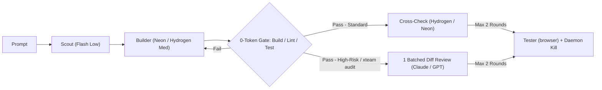

# antigravity-xteam

A quota-aware multi-model orchestration skill built exclusively for **Google Antigravity**.

> **Antigravity Only:** This skill relies on Antigravity's progressive skill loader (`SKILL.md` + `references/`), global `GEMINI.md` rules, `swarm` worker pinning and live quota inspection, `invoke_subagent` (`browser`, `image-generator`, `research`), and `manage_task` daemon controls. It is not intended for other editors or agent frameworks.

---

## Why This Exists

Running every step of a coding task on frontier models drains weekly quotas fast—especially when Claude and GPT models share a combined pool and each newly spawned worker pays a full context/tool-schema boot cost.

`antigravity-xteam` adapts automatically to whatever models and quota windows your Antigravity plan provides:

- **0-Token Static Gate:** `build`, `typecheck`, `lint`, and unit tests run *before* any LLM reviewer is invoked.
- **Short-Window Heavy Pool** (e.g., 5h reset: `Gemini 4 Neon`, `Orchestrator (Neon)`, `Gemini 4 Hydrogen`, `Gemini 3.8 Flash`): Handles codebase search, architecture, primary implementation, refactoring, and cross-check reviews.
- **Independent Weekly Pool** (e.g., `Gemini 4 Argon`): Handles secondary architecture and escalations without touching combined pools.
- **Combined Scarce Pool** (e.g., `Claude Sonnet`, `Claude Opus`, `GPT-OSS 120B`): Reserved for `xteam audit` or high-risk diffs (capped at 1 batched call per task).
- **Default Thinking Mode:** Locked to `medium` or `low` (`high` / `xhigh` are avoided unless you explicitly ask for them).

---

## Workflow



---

## Role Structure

| Role | Default Model | Fallback / Escalation | Responsibility |
| :--- | :--- | :--- | :--- |
| **Scout** | `gemini-3.8-flash` (`low` / `medium`) | `hydrogen-low` / `neon-low` | `rg -n` searches, narrow line-range reads, summaries, routine edits. |
| **Builder** | `gemini-4-neon` / `gemini-4-hydrogen` (`medium`) | `flash-medium` / `argon` | Primary implementation, refactoring, post-merge builds and test runs. |
| **Architect** | `orchestrator-neon` / `gemini-4-neon` (`medium`) | `argon` / `claude-opus-5-5-medium` | System design and hard blockers (fed concise summaries, never raw repo dumps). |
| **Reviewer** | `hydrogen` <-> `neon` / `argon` (Standard) | `claude-sonnet` / `gpt-oss-120b` (High-Risk) | Diff-only bug and security review after static checks pass. |
| **Tester** | `browser` subagent (`flash`) | — | Live UI verification against a verified `http://localhost:<port>`. |
| **Designer** | `image-generator` subagent | — | UI mockups, icons, banners, and diagrams. |

---

## Control Switches

You can steer quota usage directly from your prompt without editing any files:

- **`xteam lean`** — Zero `Claude` / `GPT` usage. Keeps everything on short-window models and static checks.
- **`xteam audit`** — Forces 1 batched `Claude` / `GPT` diff review after static checks pass (useful for auth, payments, or security-sensitive changes).

---

## Built-In Guardrails

- **Plan-Agnostic Quota Bucketing:** Inspects `swarm(action="models", all=true)` at runtime and classifies models by `quota_resets` window, so it works across different plans and future model releases.
- **Two-Stage Failover:** `< 30%` shifts routine work to short-window models; `<= 5%` triggers cross-family failover (dropping to **Single-Agent Ultra-Lean Mode** if all pools are exhausted).
- **Hot-Swap Before Compact:** Short worker sessions (`<= 15–20` messages) switch models via `swarm(action="model")`; bloated sessions are summarized in 5 lines, killed, and restarted clean.
- **Strict File Ownership & Build Lock:** Parallel `Builder` workers (max 2–3) touch disjoint paths after shared contracts are written and never run `install` or `build` concurrently.
- **2-Round Circuit Breaker:** `Builder` <-> `Reviewer` fix loops stop after 2 rounds and escalate once.
- **Daemon Cleanup:** Any `IsDaemon=true` dev server started for `browser` testing is terminated via `manage_task` immediately after verification.

---

## Installation (Antigravity)

### 1. Install the Skill (Global — Recommended)

**macOS / Linux:**
```bash
git clone https://github.com/kaankimyager/antigravity-xteam.git ~/.gemini/config/skills/antigravity-xteam
```

**Windows (PowerShell):**
```powershell
git clone https://github.com/kaankimyager/antigravity-xteam.git "$env:USERPROFILE\.gemini\config\skills\antigravity-xteam"
```

*(For a single project only, clone into `.agents/skills/antigravity-xteam` instead.)*

### 2. Optional: Enable Always-On Activation (No Need to Mention the Skill)

Copy `rules/GEMINI.md` to your global Antigravity config so every coding or debugging prompt activates `antigravity-xteam` automatically:

**macOS / Linux:**
```bash
cp ~/.gemini/config/skills/antigravity-xteam/rules/GEMINI.md ~/.gemini/config/GEMINI.md
```

**Windows (PowerShell):**
```powershell
Copy-Item "$env:USERPROFILE\.gemini\config\skills\antigravity-xteam\rules\GEMINI.md" "$env:USERPROFILE\.gemini\config\GEMINI.md"
```

---

## Test in 30 Seconds

Set your main chat model to **`Gemini 4 Neon (Medium)`** or **`Gemini 4 Hydrogen (Medium)`** and try:

1. **Standard quota-saving run:**
   > *"Refactor `src/api/auth.ts` to validate JWT expiry, run the typecheck and tests, and have a second 5h model cross-check the diff."*
2. **Zero scarce-quota run (`xteam lean`):**
   > *"xteam lean: add pagination to `/users` and verify tests pass."*
3. **Security audit run (`xteam audit`):**
   > *"xteam audit: review my webhook signature verification changes for edge cases."*

---

## Repository Layout

```text
antigravity-xteam/
├── SKILL.md                          # Core orchestrator instructions (kept lean)
├── references/
│   ├── model-roles.md                # Plan-agnostic bucketing, failover matrix, worker briefs
│   └── token-saving-rules.md         # Static-first gate, batched reviews, context hygiene
├── rules/
│   └── GEMINI.md                     # Optional always-on global rule
├── LICENSE
└── README.md
```

## License

MIT — see [LICENSE](./LICENSE).
